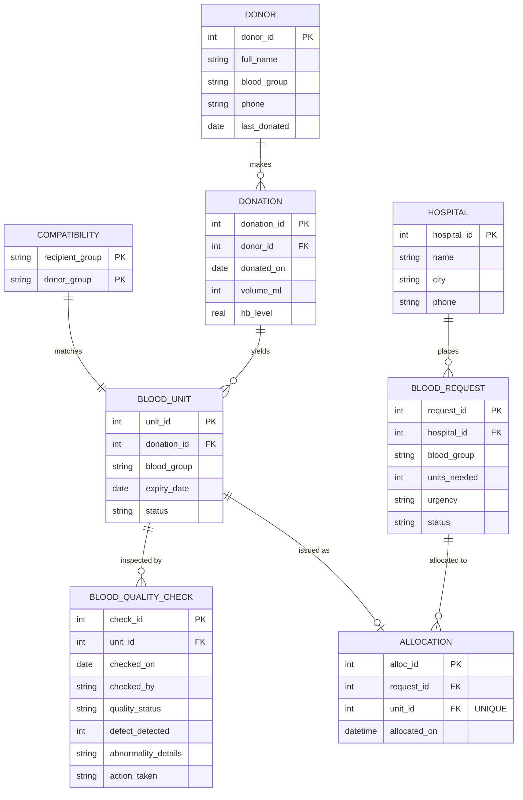

# Smart Blood Bank Management System

**Database Systems Course Project | Review 2**  
- **Presented by:** Siddhesh Srinivasan (24BYB0035)  
- **Under the guidance of:** Dr. Thanga Mariappan L  

---

## 1. Project Overview & Workflow (Slide 2)

The system models an end-to-end blood bank lifecycle across 6 distinct stages:
1. **Donor:** Registration and clinical screening (Hb level $\ge 12.0\text{ g/dL}$).
2. **Donation:** Component collection and volume recording.
3. **Blood Unit:** Tracking discrete units, shelf lives, and expiry dates.
4. **Quality Check:** Laboratory inspection, defect detection, and release/hold clearance.
5. **Inventory Match:** Compatibility matrix evaluation and FEFO (First Expiring, First Out) prioritization.
6. **Allocation:** ACID-compliant atomic transaction committing units to hospital requests.

> **Design Rule:** *Allocation is permitted only after compatibility, expiry, availability, and required quality-release checks pass.*

---

## 2. Relational Architecture & 3NF Normalization (Slides 3 & 7)

All relational tables are normalized to **Third Normal Form (3NF)**:
- **1NF (First Normal Form):** Every attribute contains atomic values; no multi-valued attributes or repeating groups.
- **2NF (Second Normal Form):** No partial dependencies on composite candidate keys (e.g., in `COMPATIBILITY(recipient_group, donor_group)`).
- **3NF (Third Normal Form):** No transitive dependencies ($X \to Y \to Z$). Donor personal details are stored exclusively in `DONOR`, not repeated in `DONATION` or `BLOOD_UNIT`. Repeatable inspections are isolated in `BLOOD_QUALITY_CHECK`.

### Entity-Relationship Diagram (ERD)



---

## 3. Transaction Management & Concurrency Control (Slides 4, 5 & 6)

### Slide 4 & 5: Atomic Allocation Transaction
```python
conn.execute("BEGIN IMMEDIATE")
try:
    # 1. Validate compatible, unexpired, quality-cleared units via FEFO
    # 2. Conditionally claim each unit:
    cursor.execute(
        "UPDATE blood_unit SET status = 'ISSUED' WHERE unit_id = ? AND status = 'AVAILABLE'",
        (unit_id,)
    )
    # Require exactly one affected row (optimistic lock verification)
    if cursor.rowcount != 1:
        raise RuntimeError(f"Concurrency conflict: Unit #{unit_id} claimed by another transaction")

    cursor.execute(
        "INSERT INTO allocation (request_id, unit_id, allocated_on) VALUES (?, ?, datetime('now'))",
        (request_id, unit_id)
    )
    conn.commit()
except Exception:
    conn.rollback()
    raise
```

### ACID Guarantees (Slide 6)
- **Atomicity:** All requested unit allocations succeed together, or the transaction rolls back completely.
- **Consistency:** `PRIMARY KEY`, `FOREIGN KEY`, `CHECK` constraints and `UNIQUE(unit_id)` preserve valid states.
- **Isolation:** SQLite `BEGIN IMMEDIATE` + WAL mode + conditional update prevents concurrent transactions from double-allocating the same blood unit.
- **Durability:** Committed allocation transactions persist across database connections and application restarts.

---

## 4. Matching & Release Rules: FEFO Algorithm (Slide 8)

Eligible units are retrieved using the exact criteria from Slide 8:
```sql
SELECT u.unit_id, u.blood_group, u.expiry_date
FROM blood_unit u
JOIN compatibility c ON c.donor_group = u.blood_group
WHERE c.recipient_group = :requested_group
  AND u.status = 'AVAILABLE'
  AND u.expiry_date > DATE('now')
  -- Must have passed laboratory quality inspection
  AND EXISTS (
      SELECT 1 FROM blood_quality_check qc
      WHERE qc.unit_id = u.unit_id
        AND qc.quality_status = 'PASSED'
  )
  -- Must NOT have unresolved holds or failed inspections
  AND NOT EXISTS (
      SELECT 1 FROM blood_quality_check qc
      WHERE qc.unit_id = u.unit_id
        AND (qc.quality_status != 'PASSED' OR qc.action_taken IN ('QUARANTINED', 'DISCARDED'))
  )
ORDER BY u.expiry_date ASC, u.unit_id ASC;
```

---

## 5. Slide 9: Integrity Triggers & Analytical Reports

### Database Triggers:
1. `trg_update_donor_last_donated`: Automatically syncs `donor.last_donated` on every new donation.
2. `trg_sync_unit_status_on_allocation`: Sets `blood_unit.status = 'ISSUED'` upon insertion into `allocation`.
3. `trg_prevent_ineligible_allocation`: Database-level trigger aborting direct allocation of unverified or expired units.
4. `trg_update_request_status_on_allocation`: Automatically transitions `blood_request.status` to `'PARTIALLY_FULFILLED'` or `'FULFILLED'`.
5. `trg_sync_unit_status_on_quality_check`: Automatically updates `blood_unit.status` to `'DISCARDED'` or `'QUARANTINED'` when laboratory checks fail.

### 4 Analytical Reports:
- **Inventory Report:** Stock grouped by blood group with total available units and volume.
- **Expiry Report:** Units nearing expiry prioritized by FEFO (Critical $\le 3$ days, Approaching $\le 7$ days).
- **Quality & Hold Report:** Metrics for pending initial checks, quarantined units, discarded units, and audit logs.
- **Request Fulfillment Report:** Requested vs. allocated quantities with fulfillment percentages.

---

## 6. Running the Project

### Prerequisites
- Python 3.10+ (with SQLite 3 built-in)
- Virtual environment with dependencies installed

### Quickstart

1. **Activate Environment & Seed Database:**
   ```bash
   cd ~/workspace/projects/course/BloodBankManager
   source .venv/bin/activate
   python3 seed_data.py
   ```

2. **Run Automated Unit & Integration Tests:**
   ```bash
   PYTHONPATH=. .venv/bin/pytest tests/test_system.py -v
   ```

3. **Run Multi-Threaded Concurrency & ACID Race-Condition Test:**
   ```bash
   .venv/bin/python3 test_concurrency.py
   ```

4. **Launch Web Application:**
   ```bash
   .venv/bin/python3 run.py
   ```
   Open your browser at: **`http://127.0.0.1:5000`**
